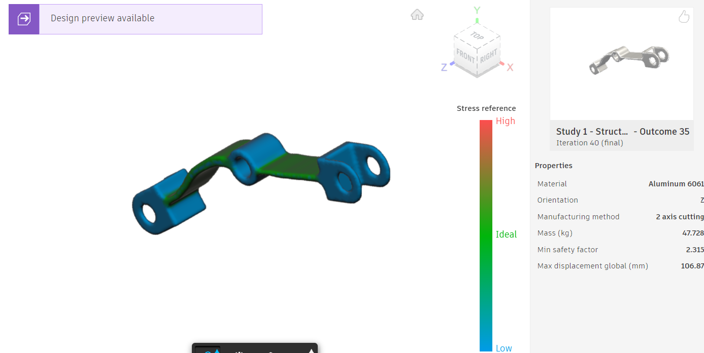
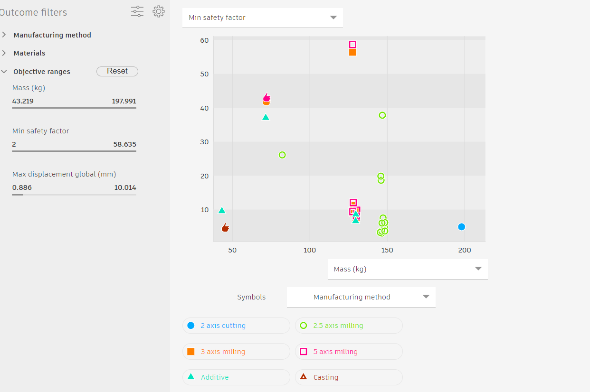
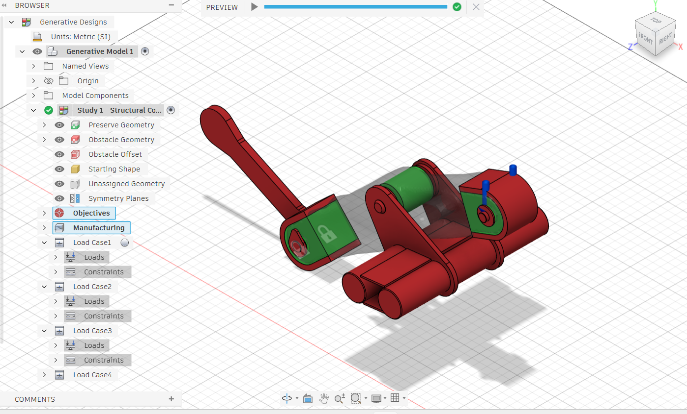

# Front-Loader-Generative-Design
Lightweighting and generative design redesign of a heavy duty front loader component in Autodesk Fusion
# Front Loader Component Generative Design

## Overview
Redesigned a heavy-duty structural front loader component using **Autodesk Fusion Generative Design** to reduce overall component mass while maintaining structural stiffness and safety factor requirements under operational load cases.

## 📄 Technical Report
* **[View Full Project Report (PDF)](Front-Loader-Generative-Design-Report.pdf)** — Covers load case definitions, preserve/obstacle geometry setup, material selection, trade-off study across manufacturing methods, and mass reduction metrics.

## Key Results
* **Mass Optimization:** Generated multiple organic topology outcomes constrained by real-world manufacturing methods (unrestricted, milling, additive, and casting).
* **Optimal Manufacturing Selection:** Evaluated trade-offs in weight reduction, stress distribution, and production feasibility, identifying **casting** as the best manufacturing method for the final redesigned component.
* **Structural Integrity:** Verified that the selected casting geometry met target factor-of-safety thresholds without yielding under peak operating loads.

## Visuals & Design Outcomes
### Selected Casting Outcome

## Tools & Methods
* **CAD & Topology Optimization:** Autodesk Fusion (Generative Design Workspace)
* **Engineering Concepts:** Design for Manufacturing (DFM), Preserve & Obstacle Geometry Definition, Structural Load Path Optimization
